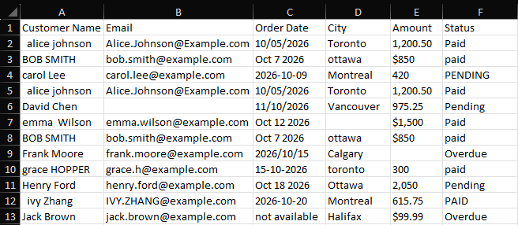
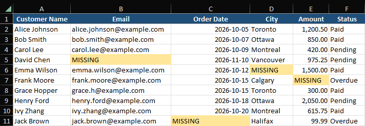
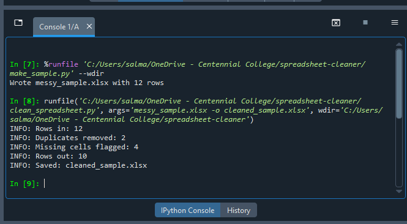

# Spreadsheet Cleaner

A Python script that turns a messy CSV or Excel file into a clean, formatted Excel report with one command.

**Before**



**After**



**Run output**



## What it does

- Trims extra spaces and fixes inconsistent capitalization (names, cities, statuses)
- Lowercases emails
- Converts mixed date formats into one format (`YYYY-MM-DD`)
- Converts amounts like `$1,200.50` into real numbers
- Removes exact duplicate rows
- Flags missing values as `MISSING` (highlighted) instead of guessing
- Logs a short summary: rows in, duplicates removed, missing cells, rows out

## Setup

```bash
pip install -r requirements.txt
```

## Usage

```bash
# 1. (Optional) create a fake messy sample file
python make_sample.py

# 2. Clean a file
python clean_spreadsheet.py messy_sample.xlsx -o cleaned_sample.xlsx
```

Works with `.csv` and `.xlsx` input. If `-o` is omitted, the output is saved as `<input>_cleaned.xlsx`.

## Notes and limits

- Slash dates such as `10/05/2026` are read as month/day/year. Change `DATE_FORMATS` in the script if your data uses day/month/year.
- The script expects columns named `Customer Name`, `Email`, `Order Date`, `City`, `Amount`, `Status`. Columns it doesn't recognize are only trimmed. It's easy to adapt to other layouts.
- All data in the sample file is fake.

## Tech

Python, pandas, openpyxl
